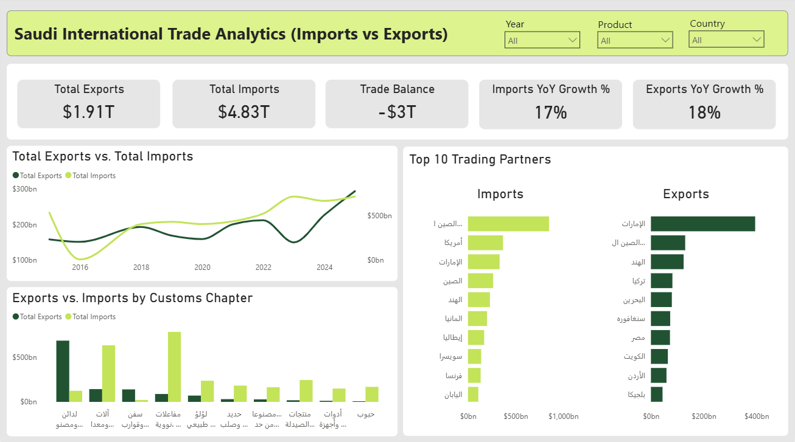

# Saudi Arabia International Trade Analysis (2015 - 2025)

## Project Overview

This project delivers an end-to-end Data Warehouse and Business Intelligence (BI) solution to analyze **Saudi Arabia's Import and Export dynamics** over a 10-year timeline (2015–2025), except 2017.

Leveraging the **Modern Data Stack** architecture, the project ingests fragmented and raw public datasets, handles extensive data quality issues via an automated programmatic pipeline, and builds an enterprise-ready **Star Schema** data model. The final output is an executive-level, single-page interactive dashboard that tracks macroeconomic trends, trade balances, product portfolio performance, and top geopolitical trading partners.

### Project Architecture

```text
[1. Data Sources] ---> [2. Ingestion Layer] ---> [3. Data Warehouse] ---> [4. BI Layer]

33 Raw Excel Files       Python (Pandas)          SQL Server (T-SQL)       Power BI Desktop
(Mismatched Schemas)     Strict Schema            Dynamic ETL &            Import Mode /
                         Enforcement              Fact Tables              Star Schema
```

## Business Objectives

This Business Intelligence (BI) solution is engineered to transform raw customs documentation into a high-level strategic asset, directly answering key macroeconomic questions and supporting evidence-based decision-making. The primary business objectives include:

- **Macroeconomic Trend Monitoring:** Provide government stakeholders and trade analysts with an instant, unified view of Saudi Arabia’s trade lifecycle across a horizon up to 2025, tracking the historical momentum of foreign trade.
- **Trade Balance Optimization:** Systematically isolate and monitor periods of **Trade Surplus vs. Trade Deficit**, allowing policymakers to identify structural gaps where import dependency can be minimized and local production can be incentivized.
- **Diversification Tracking (Vision 2030 Alignment):** Unpack the performance of the **97 HS Customs Chapters** to evaluate the growth of non-oil exports, measuring the Kingdom's progress toward economic diversification and manufacturing maturity.
- **Geopolitical Trade Partner Analysis:** Map and rank the Kingdom’s global procurement channels (Top Import Sources) and product demand destinations (Top Export Partners) to evaluate supply chain resilience, monitor dependency risks, and identify high-value emerging markets.

## Dashboard Preview



## Tools & Technologies

- **Microsoft SQL Server (T-SQL):** Data Warehouse development and automated ETL design.
- **Python (Pandas & SQLAlchemy):** Automated data ingestion and programmatic folder scanning.
- **Power BI Desktop:** Dashboard development.
- **DAX (Data Analysis Expressions):** KPI calculations.

## Data Source

- **Publishing Entity:** Zakat, Tax and Customs Authority.
- **Data Portal:** Saudi National Open Data Platform.
- **Reporting Timeline:** Comprehensive time series covering 2015 to 2025, including granular quarterly tracking for recent cycles.
- **Currency:** Saudi Riyal (SAR).

## The Data Journey: From Raw Chaos to Executive Insights

### 1. The Raw Data State (Excel Phase)

The journey began with raw trade datasets downloaded from the National Open Data Portal. The data was highly unorganized and fragmented across 33 separate Excel files.

- The files were heavily siloed: some contained full years, some combined two quarters, while others isolated a single quarter.
- Visually, the files were inconsistent, utilizing different fonts, row stylings, and structural layouts, which made immediate analysis impossible.

### 2. Ingestion & Database Design (Python & SQL Phase)

To build a clean foundation, all 33 files were consolidated using a programmatic pipeline:

- **Python Pipeline:** A script automatically scanned the local folder and loaded the raw data into SQL Server staging tables with strict data types.
- **T-SQL Warehouse:** A dynamic SQL script automatically looped through all 33 tables, fixed structural differences, and merged everything into two clean tables: `Fact_Imports` and `Fact_Exports`.
- **Product Dimension (`Dim_HS_Code`):** Imported the master reference table containing the 97 standard customs chapters to group and filter trade products by their names.

### 3. Data Modeling (Power BI Phase)

The clean tables were connected to Power BI Desktop using **Import Mode** for maximum performance and fast visual rendering:

- **Unified Calendar (`Dim_Date`):** Created a dynamic, continuous date table directly in Power BI to handle all time-based analysis and charts.
- **Star Schema Architecture:** Built a standard **Star Schema** model where the dimension tables (`Dim_Date` and `Dim_HS_Code`) easily filter the transactional fact tables through clean **One-to-Many (1 to *)** relationships.

### 4. Interactive Dashboard Implementation

Designed a clean and modern single-page analytical portal using standard Power BI visuals for clear and fast reading:

- **KPI Cards:** Placed five dynamic cards at the top (Total Exports, Total Imports, Trade Balance, Imports YoY Growth %, and Exports YoY Growth %) to give an instant summary.
- **Line Chart:** Positioned a left central chart showing total exports vs. imports over the years.
- **Clustered Column Chart:** Developed a chart at the bottom-left to compare total exports and total imports directly by their explicit Arabic product descriptions.
- **Clustered Bar Charts (Geopolitical Trade Allocation):** Positioned two side-by-side charts at the bottom-right to isolate and rank the Top 10 countries for imports (in yellow) and exports (in green) at a single glance.

## Key Observations

- **The Trade Gap:** The top cards show a significant gap between Total Imports ($4.83T) and Total Exports ($1.91T). This creates a negative Trade Balance of (-$2.92T). This indicates that the specific product categories analyzed rely heavily on foreign procurement.
- **Import Spike After 2023:** The chart in the middle shows that imports and exports were very close until 2022. However, after 2023, imports jumped quickly. This shows a huge increase in local demand or spending on major national mega-projects.
- **Top Products:** The product chart shows that "Nuclear reactors, boilers, machinery and mechanical appliances; parts thereof" is the number one imported product (highest yellow column). On the other side, "Plastics and Articles Thereof" is the strongest product exported by Saudi Arabia (highest green column).
- **Top Countries:** The country chart shows that China is the main country Saudi Arabia buys from, and second is America. As for exports, the United Arab Emirates, China, and India rank as the top three destinations for Saudi exports.

## Strategic Recommendations

- **Accelerate Local Manufacturing:** Since "Nuclear reactors, boilers, machinery and mechanical appliances; parts thereof" takes the biggest share of import spending, the Kingdom can support local factories to make this heavy equipment and its spare parts locally. This will help lower the import bill.
- **Supply Chain Diversification:** Relying heavily on one country for imports can be risky if global supply chains slow down. Finding and growing trade with other major countries (like Germany or Japan) will help share and lower that risk.
- **Leverage Competitive Export Strengths:** Since the "Plastics" sector is a proven winner for Saudi exports, supporting these factories to expand into new global markets beyond the UAE and India will quickly increase non-oil revenues.

## Data Engineering Challenges & Solutions

### Challenge 1: Inconsistent Column Names and Spaces

- **Problem:** Because the data covered 10 years, column names changed between files (like `[الدولة]` vs. `[دولة]`), and many contained hidden spaces or text errors (like `الربع` vs. `الربع `).
- **Solution:** Wrote a smart **Dynamic SQL script** that automatically scanned the columns of all tables using keywords (like `LIKE '%قيمة%'`). This allowed the system to find the correct columns instantly, ignoring typos or hidden spaces.

### Challenge 2: Text-Based Dates

- **Problem:** Time fields were saved as text strings (like `Q4-2016`), which made it impossible to build continuous timeline charts or trend lines in Power BI.
- **Solution:** Built a conversion logic in the SQL pipeline that read the text quarters and transformed them into standard dates (for example, mapping Q1 directly to `YYYY-01-01`).

### Challenge 3: Missing Zeros in Customs Codes

- **Problem:** Standard 2-digit customs codes starting with zero (like `01` or `05`) were read by Excel as normal numbers. This stripped the leading zero (making them `1` or `5`), which broke data relationships later on.
- **Solution:** Forced a strict text format (`VARCHAR`) during both the Python loading phase and the SQL staging process. This kept the zeros safe and protected the true format of the customs codes.

### Challenge 4: The 2017 Missing Data Gap

- **Problem:** The original source data had no records at all for the entire year of 2017. If handled incorrectly, this could break Power BI's automatic time calculations.
- **Solution:** Instead of making up fake data, I kept the data real and honest. I built a continuous calendar table (`Dim_Date`) in Power BI, which allowed the charts to display 2017 smoothly as an organic, empty gap.
